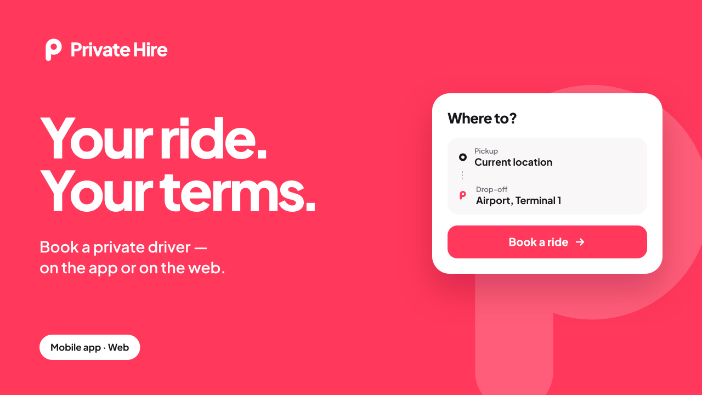

# Private Hire Cars - online booking system



A responsive web application (desktop and phone browsers) with a REST API and a PostgreSQL database, built for the
COMP1807 Agile Scrum coursework. It implements the group report's backlog v3 (101 stories, 8 actors); see
[docs/TRACEABILITY.md](docs/TRACEABILITY.md). The API (`/api/v1`, JSON) is designed so a native mobile app can reuse it.

| Actor (report Table 7) | What they can do |
|---|---|
| **Visitor** | Get a fare estimate, read Help and FAQ, register, send an enquiry, report a lost item with a booking reference |
| **Customer** | Verify email, book online (15% off, priority) with luggage, child seats, pet, accessibility, flight number, return journey or a daily hire package; pay by card with 3D Secure, PayPal, bank or cash to the driver; coupons; receipts (print, PDF, send, history with credit notes); cancel or amend up to 24 hours before; notifications, reminders, trip sharing, emergency button; reviews; lost items and complaints; favourite places; download or delete my data |
| **Business Booker / Business Account Admin** | Book on a company account with a cost centre; the admin invites bookers, sees company spend and pays the monthly invoice |
| **Call Centre Staff** | Find and verify callers (secret word), create caller accounts, book and record payment, dispatch, journey status, refunds up to £50 per booking per day, extra charges, change destination, cancel or amend with a reason, lost property, complaints, enquiries, customer notes |
| **Manager** | Everything staff can do, plus fleet and documents, prices and surcharges, coupons and offers, company approvals and invoices, reports and the bookings-by-channel dashboard, any refund amount, action on drivers |
| **Admin** | Staff accounts and roles, settings, audit log, background jobs (reminders, retention) - no bookings (separation of duties) |
| **Driver** (simulated view) | My jobs on a phone: on my way, arrived, picked up, completed (collect cash), running late, breakdown, found item |

Payments (3D Secure, VISA Check, PayPal, pay by bank), texts and GPS are **simulated** behind service modules; email is
simulated too unless `SMTP_HOST` points at the Mailpit test inbox. See [docs/ARCHITECTURE.md](docs/ARCHITECTURE.md).
Every email and text is in the app (customer Messages, staff Outbox).

## Quick start

Requirements: Node 20+ and Docker.

```bash
docker compose up -d db                 # PostgreSQL 16 on localhost:5433
cd server && npm install
npm run db:demo                         # tables + demo data (customers, history, reviews, a company account, coupons)
npm run dev                             # API on http://localhost:4000 (API reference at /api/docs in development)
```

```bash
cd web && npm install && npm run dev    # web app on http://localhost:5173 (proxies /api to :4000)
```

Optional test inbox for real emails (receipts arrive with the PDF attached):
`docker compose --profile mail up -d mail`, set `SMTP_HOST=localhost` in `server/.env`, open http://localhost:8025.

Everything in one container (API + built web app + Mailpit): `docker compose --profile full up --build`, then open
http://localhost:4000 (inbox on http://localhost:8025).

Scripts in `server/`: `npm run migrate`, `npm run seed`, `npm run seed:demo`, `npm run db:reset`, `npm run db:demo`,
`npm test` (171 tests), `npm run docs:api` (regenerates `docs/API.md`).

## Demo accounts

| Role | Email | Password | Sign in at |
|---|---|---|---|
| Customer (also admin of "Morgan Consulting Ltd") | customer@privatehire.test | Customer123! | `/login` |
| Call Centre Staff | staff@privatehire.test | StaffPass123! | `/staff/login` |
| Manager | manager@privatehire.test | ManagerPass123! | `/staff/login` |
| Admin | admin@privatehire.test | AdminPass123! | `/staff/login` |
| Driver (Mohammed Khan) | driver@privatehire.test | DriverPass123! | `/staff/login` -> `/driver` |

Other demo customers (password `Customer123!`): priya.shah@ (books for Morgan Consulting), tom.becker@ (company
application waiting for the Manager), grace.liu@, omar.haddad@, hannah.moore@, luca.romano@ `example.com`.
Opted-in customers have a £5 coupon `WELCOME5` in My coupons.

**Payments (simulated):** Visa `4242 4242 4242 4242`, Mastercard `5555 5555 5555 4444`, Amex `3782 822463 10005`
(any future expiry, any 3-digit code, 4 for Amex). Declined `4000 0000 0000 0002`; no funds `4000 0000 0000 9995`.
The 3D Secure code is `123456`. PayPal: any email and password. Pay by bank: choose any bank.

**Verifying a caller (call desk):** Alex Morgan's secret word is `bluebird`, postcode `SW1A 2AA`, phone ends `0123`.

**Test hooks:** email to an address ending `@fail.test` and texts to a number ending `0000` always fail (to show the
3 retries and the Failed status).

## Repository layout

```
server/   Express API, SQL migrations (db/migrations 001-014), seed data, 171 automated tests (node --test)
web/      React + Vite single-page app, plain-CSS design system
docs/     SPRINTS.md (plan + delivery log), TRACEABILITY.md (report story -> code -> test), API.md (generated),
          ARCHITECTURE.md, reference/ (user stories, design references), brand/
```

## Tech

Node 22, Express 5, PostgreSQL 16 (`pg`), zod validation, bcrypt, server-side sessions in HttpOnly cookies, pdfkit
(receipt PDFs), nodemailer (SMTP to Mailpit), React 18 + React Router 7, Vite. Design: layout and pill controls from the
Uber reference, colours from the Airbnb reference and the Private Hire brand kit (Private Pink `#FF385C`), Plus Jakarta Sans.

## How it was built

Scrum sprints with one branch per module, merged to `main` with a merge commit (see `git log --graph`). Tags `sprint-1`
to `sprint-3` mark the first increments; the `backlog-v3/*` modules bring the product in line with the group report.
Goals, Definition of Done, assumptions and the delivery log are in [docs/SPRINTS.md](docs/SPRINTS.md).
